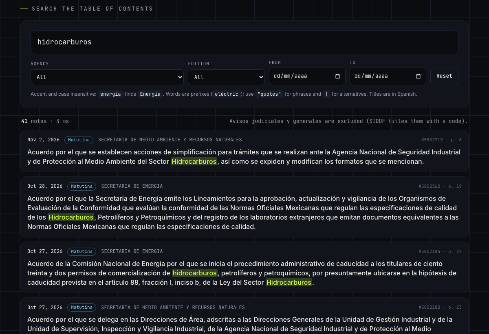

<p align="center">
  
</p>

<p align="center">
  <a href="README.md">English</a> · <b>Español</b>
</p>

<p align="center">
  <a href="https://github.com/BEG-lag/dof-diario/actions/workflows/update.yml"></a>
  <a href="https://github.com/BEG-lag/dof-diario/actions/workflows/ci.yml"></a>
  
  
  
</p>

**dof-diario** es un dataset abierto y vivo del sumario del *Diario Oficial de la Federación*
(DOF), donde se publican las leyes, decretos, reglamentos y NOM federales. GitHub Actions consulta
la API oficial de SIDOF después de las ediciones matutina y vespertina y guarda lo nuevo en el
repositorio. Un sitio estático permite buscar en él.

**Sitio:** [beg-lag.github.io/dof-diario](https://beg-lag.github.io/dof-diario/) · **Datos:**
[`data/`](data) · **Esquema:** [`schema/day.schema.json`](schema/day.schema.json)

<p align="center">
  
</p>
<p align="center"><sub>Captura real del sitio servido en local (interfaz en inglés): 41 títulos coinciden con <code>hidrocarburos</code>, filtrados en el navegador en 3 ms.</sub></p>

## Qué contiene

Carga inicial hecha el 17-11-2026 con `dof-diario backfill` desde el 01-01-2025 (682 peticiones,
345 s):

| | |
| --- | --- |
| Días con al menos una edición | **484** (del 02-01-2025 al 17-11-2026) |
| Notas | **43,994**, de las cuales 33,305 (75.7%) son *avisos judiciales y generales* |
| Notas con título en el índice de búsqueda | **10,689** de **103** dependencias |
| Emisor más activo | Banco de México, 1,606 notas (tipo de cambio, TIIE, circulares) |
| Mes con más publicaciones | diciembre de 2025, 719 notas con título |
| Tamaño | 19.9 MB de JSON en disco, 2.7 MB comprimidos en git |

Los distintivos de arriba leen `data/meta.json`, así que se actualizan solos conforme el robot
agrega días.

## Usa los datos

Cada día con publicación es un archivo, `data/AAAA/MM/AAAA-MM-DD.json`:

```bash
curl -s https://raw.githubusercontent.com/BEG-lag/dof-diario/main/data/2026/11/2026-11-13.json \
  | jq '.notes[] | select(.aviso | not) | {id, agency, title, url}' | head -6
```

```json
{
  "id": 5803757,
  "agency": "PRESIDENCIA DE LA REPUBLICA",
  "title": "Decreto por el que se expide la Ley de Ingresos de la Federación para el Ejercicio Fiscal de 2027.",
  "url": "https://dof.gob.mx/nota_detalle.php?codigo=5803757&fecha=13/11/2026"
}
```

```python
import json, pathlib

notes = [
    note
    for path in sorted(pathlib.Path("data").glob("2026/*/*.json"))
    for note in json.loads(path.read_text())["notes"]
    if not note["aviso"]
]
```

Cada nota trae `id` (el `codNota` de SIDOF), `edition` (`matutina`, `vespertina`,
`extraordinaria`), `order`, `section`, `diario_id`, `page`, `branch`, `branch_code`, `agency`
(dependencia), `title`, `aviso`, `has_doc`, `has_pdf` y `url` (página oficial en dof.gob.mx). Cada
día también lista sus ediciones con la liga al PDF completo. El [JSON Schema](schema/day.schema.json)
documenta cada campo y las pruebas validan todos los archivos contra él en cada actualización.

Los archivos no llevan marcas de tiempo y se escriben en orden determinista, así que solo hay
commit cuando el DOF realmente cambió. Los días sin edición (fines de semana, días inhábiles) no
tienen archivo.

## Cómo funciona

```mermaid
flowchart LR
    A["cron 08:15 y 22:15<br/>Ciudad de México"] --> B["GitHub Actions<br/>dof-diario update"]
    B -- "GET /notas/{fecha}<br/>últimos 4 días, 1 s entre llamadas" --> C[("API SIDOF")]
    C --> D["normalizar<br/>quitar separadores,<br/>marcar avisos"]
    D --> E["data/AAAA/MM/*.json<br/>solo si cambió"]
    E --> F["pytest<br/>JSON Schema + integridad"]
    F --> G["commit como<br/>github-actions[bot]"]
    G --> H["generar docs/data<br/>índices de búsqueda y estadísticas"]
    H --> I["GitHub Pages<br/>sitio estático"]
```



| Horario (cron, UTC) | Ciudad de México (UTC-6, sin horario de verano desde 2022) | Para qué |
| --- | --- | --- |
| `15 14 * * *` | 08:15 | después de la edición matutina |
| `15 4 * * *` | 22:15 | después de la mayoría de las vespertinas |

Cada corrida vuelve a consultar los últimos 4 días, para recoger ediciones tardías y correcciones.
También se puede lanzar a mano desde la pestaña Actions (`workflow_dispatch`, con número de días
configurable). Las peticiones van una por una, con al menos un segundo entre ellas en CI,
reintentos, backoff exponencial y un `User-Agent` descriptivo.

## El sitio

HTML, CSS y JavaScript simples en [`docs/`](docs), sin paso de compilación ni scripts de terceros.
Carga un índice compacto por año (unos 0.3 MB comprimido por año) y busca en el navegador: ignora
acentos y mayúsculas, busca por prefijo (`eléctric`), acepta `"frases"` y alternativas `a | b`,
y filtra por dependencia, edición y rango de fechas. Cada resultado liga a la página oficial del
DOF. Las gráficas muestran notas por mes (clic en un mes para buscarlo) y las dependencias más
activas (clic para filtrar). En español e inglés, con URLs para compartir, y funciona en el
celular.

## Córrelo tú

```bash
uv sync
uv run dof-diario backfill --start 2025-01-01   # se puede reanudar con --skip-existing
uv run dof-diario update --days 4               # lo que corre el flujo programado
uv run dof-diario build-site                    # regenera docs/data a partir de data/
uv run pytest                                   # pruebas + validación del dataset
python -m http.server 8000 --directory docs     # abre http://localhost:8000
```

## Estructura

```text
src/dof_diario/
  sidof.py       cliente SIDOF: secuencial, reintentos, backoff, User-Agent
  normalize.py   de la respuesta de SIDOF al registro diario estable
  store.py       un archivo por día, una nota por línea, escribe solo si cambia
  site.py        índices de búsqueda y estadísticas para docs/data
  cli.py         update, backfill, build-site, stats
schema/          JSON Schema de un archivo diario
data/            el dataset (un JSON por día) y meta.json
docs/            el sitio de GitHub Pages y sus índices generados
tests/           22 pruebas: normalización, guardado, archivo, sitio, validación del dataset
scripts/         banner.py (la gráfica del banner se dibuja con los datos)
```

## Limitaciones

- **Solo el índice.** Títulos, dependencias, páginas y ligas, no los textos completos ni los PDF.
  Para texto completo usa el servidor MCP hermano [mcp-dof](https://github.com/BEG-lag/mcp-dof).
- **Los avisos no tienen títulos útiles.** SIDOF lista los *avisos judiciales y generales* como
  `Aviso REF:581596`, así que se guardan y se cuentan, pero no entran al índice de búsqueda.
- **Aún no hay renglones "extraordinaria".** Entre el 01-01-2025 y el 17-11-2026 SIDOF no registró
  notas en `NotasExtraordinarias`; las ediciones de fin de semana o día inhábil (por ejemplo
  02-02-2025 y 14-09-2025) aparecen como vespertina o matutina. El esquema admite el valor si SIDOF
  empieza a usarlo.
- **La cobertura empieza el 01-01-2025.** Los años anteriores se pueden cargar con el mismo comando.
- **Cambios en la fuente.** La API de SIDOF no está documentada; si cambia, la corrida programada
  falla de forma visible en vez de guardar datos malos. GitHub puede retrasar unos minutos las
  corridas programadas y pausarlas en repositorios inactivos.

## Aviso

No oficial: solo el DOF impreso/oficial es fuente auténtica; no constituye asesoría legal. Este
proyecto no está afiliado a la Secretaría de Gobernación ni al DOF. Los datos provienen de la API
pública de SIDOF y pueden tener errores u omisiones; verifica contra la publicación oficial.

## Autor

Hecho por **Benjamín Esponda García**, abogado corporativo mexicano (energía, hidrocarburos y
minería) que construye con IA. Más en [pivotek.mx](https://pivotek.mx) y en el
[portafolio](https://github.com/BEG-lag/portafolio-ia).

Código bajo la [licencia MIT](LICENSE). Datos en dominio público bajo CC0 ([DATA-LICENSE.md](DATA-LICENSE.md)).
