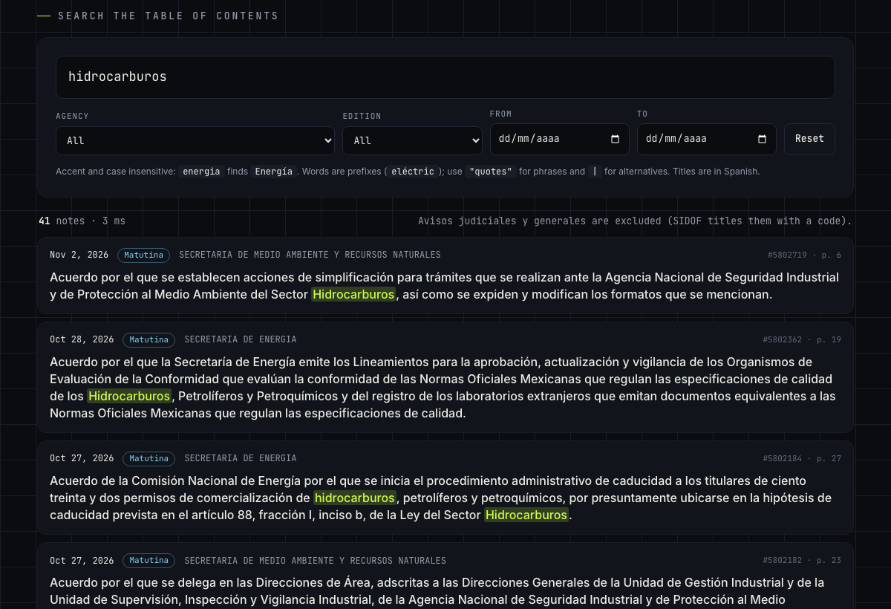

<p align="center">
  
</p>

<p align="center">
  <b>English</b> · <a href="README.es.md">Español</a>
</p>

<p align="center">
  <a href="https://github.com/BEG-lag/dof-diario/actions/workflows/update.yml"></a>
  <a href="https://github.com/BEG-lag/dof-diario/actions/workflows/ci.yml"></a>
  
  
  
</p>

**dof-diario** is a living, open dataset of the table of contents of Mexico's *Diario Oficial de la
Federación* (DOF), the official gazette where federal laws, decrees, regulations and NOMs are
published. GitHub Actions checks the official SIDOF API after the morning and evening editions and
commits whatever is new. A static site lets anyone search it.

**Site:** [beg-lag.github.io/dof-diario](https://beg-lag.github.io/dof-diario/) · **Data:**
[`data/`](data) · **Schema:** [`schema/day.schema.json`](schema/day.schema.json)

<p align="center">
  
</p>
<p align="center"><sub>Real screenshot of the site served locally: 41 titles match <code>hidrocarburos</code>, filtered in the browser in 3 ms.</sub></p>

## What is in it

Backfilled on 2026-11-17 by running `dof-diario backfill` from 2025-01-01 (682 requests, 345 s):

| | |
| --- | --- |
| Days with at least one edition | **484** (2025-01-02 to 2026-11-17) |
| Notes | **43,994**, of which 33,305 (75.7%) are *avisos judiciales y generales* |
| Titled notes in the search index | **10,689** from **103** issuing agencies |
| Most active issuer | Banco de México, 1,606 notes (exchange rate, TIIE, circulars) |
| Busiest month | December 2025, 719 titled notes |
| Size | 19.9 MB of JSON on disk, 2.7 MB packed in git |

The badges above read `data/meta.json`, so they stay current as the robot adds days.

## Use the data

Every day with a publication is one file, `data/YYYY/MM/YYYY-MM-DD.json`:

```bash
curl -s https://raw.githubusercontent.com/BEG-lag/dof-diario/main/data/2026/11/2026-11-13.json \
  | jq '.notes[] | select(.aviso | not) | {id, agency, title, url}' | head -6
```

```json
{
  "id": 5803757,
  "agency": "PRESIDENCIA DE LA REPUBLICA",
  "title": "Decreto por el que se expide la Ley de Ingresos de la Federación para el Ejercicio Fiscal de 2027.",
  "url": "https://dof.gob.mx/nota_detalle.php?codigo=5803757&fecha=13/11/2026"
}
```

```python
import json, pathlib

notes = [
    note
    for path in sorted(pathlib.Path("data").glob("2026/*/*.json"))
    for note in json.loads(path.read_text())["notes"]
    if not note["aviso"]
]
```

Each note carries `id` (SIDOF `codNota`), `edition` (`matutina`, `vespertina`, `extraordinaria`),
`order`, `section`, `diario_id`, `page`, `branch`, `branch_code`, `agency`, `title`, `aviso`,
`has_doc`, `has_pdf` and `url` (official page on dof.gob.mx). Each day also lists its editions with
links to the full PDF. The [JSON Schema](schema/day.schema.json) documents every field and the test
suite validates all files against it on every update.

The files hold no timestamps and are written in a deterministic order, so a commit appears only
when the DOF actually changed. Days without an edition (weekends, holidays) have no file.

## How it works

```mermaid
flowchart LR
    A["cron 08:15 and 22:15<br/>Mexico City"] --> B["GitHub Actions<br/>dof-diario update"]
    B -- "GET /notas/{fecha}<br/>last 4 days, 1 s apart" --> C[("SIDOF API")]
    C --> D["normalize<br/>drop separator rows,<br/>flag avisos"]
    D --> E["data/YYYY/MM/*.json<br/>written only if changed"]
    E --> F["pytest<br/>JSON Schema + integrity"]
    F --> G["commit as<br/>github-actions[bot]"]
    G --> H["build docs/data<br/>search + stats indexes"]
    H --> I["GitHub Pages<br/>static site"]
```



| Schedule (cron, UTC) | Mexico City (UTC-6, no DST since 2022) | Purpose |
| --- | --- | --- |
| `15 14 * * *` | 08:15 | after the matutina (morning) edition |
| `15 4 * * *` | 22:15 | after most vespertina (evening) editions |

Each run re-fetches the last 4 days, so late editions and corrections are picked up. It can also
be run by hand from the Actions tab (`workflow_dispatch`, with a configurable number of days).
Requests are sequential, at least one second apart in CI, with retries, exponential backoff and a
descriptive `User-Agent`.

## The site

Plain HTML, CSS and JavaScript in [`docs/`](docs), no build step and no third-party scripts.
It loads a compact per-year index (about 0.3 MB gzipped per year) and searches in the browser:
accent and case insensitive, prefix matching (`eléctric`), `"phrases"` and `a | b` alternatives,
with filters by agency, edition and date range. Every result links to the official DOF page.
Charts show notes per month (click a month to search it) and the most active agencies (click to
filter). Spanish and English, shareable URLs, works on a phone.

## Run it yourself

```bash
uv sync
uv run dof-diario backfill --start 2025-01-01   # resumable with --skip-existing
uv run dof-diario update --days 4               # what the scheduled workflow runs
uv run dof-diario build-site                    # rebuild docs/data from data/
uv run pytest                                   # unit tests + dataset validation
python -m http.server 8000 --directory docs     # open http://localhost:8000
```

## Project structure

```text
src/dof_diario/
  sidof.py       SIDOF client: sequential, retries, backoff, User-Agent
  normalize.py   raw SIDOF payload to the stable day record
  store.py       one file per day, one note per line, write only on change
  site.py        search and stats indexes for docs/data
  cli.py         update, backfill, build-site, stats
schema/          JSON Schema of a day file
data/            the dataset (one JSON per day) and meta.json
docs/            the GitHub Pages site and its generated indexes
tests/           22 tests: normalization, storage, archiving, site, dataset validation
scripts/         banner.py (the banner chart is drawn from the data)
```

## Limitations

- **Index only.** Titles, issuers, pages and links, not the full texts or PDFs. For full text, use
  the companion MCP server [mcp-dof](https://github.com/BEG-lag/mcp-dof).
- **Avisos have no useful titles.** SIDOF lists *avisos judiciales y generales* as
  `Aviso REF:581596`, so they are stored and counted but left out of the search index.
- **No "extraordinaria" rows yet.** Between 2025-01-01 and 2026-11-17 SIDOF filed no notes under
  `NotasExtraordinarias`; weekend and holiday editions (for example 2025-02-02 and 2025-09-14)
  appear as vespertina or matutina. The schema supports the value if SIDOF starts using it.
- **Coverage starts on 2025-01-01.** Older years can be backfilled with the same command.
- **Upstream changes.** The SIDOF API is undocumented; if it changes, the scheduled run fails
  visibly instead of committing bad data. GitHub can delay scheduled runs by some minutes and may
  pause schedules in inactive repositories.

## Disclaimer

Unofficial: only the printed/official DOF is authoritative; not legal advice. This project is not
affiliated with the Secretaría de Gobernación or the DOF. The data comes from the public SIDOF API
and may contain errors or gaps; verify against the official publication.

## Author

Built by **Benjamín Esponda García**, a Mexican corporate lawyer (energy, hydrocarbons and
mining) who builds with AI. More at [pivotek.mx](https://pivotek.mx) and in the
[portfolio](https://github.com/BEG-lag/portafolio-ia).

Code released under the [MIT License](LICENSE). Data dedicated to the public domain under CC0 ([DATA-LICENSE.md](DATA-LICENSE.md)).
